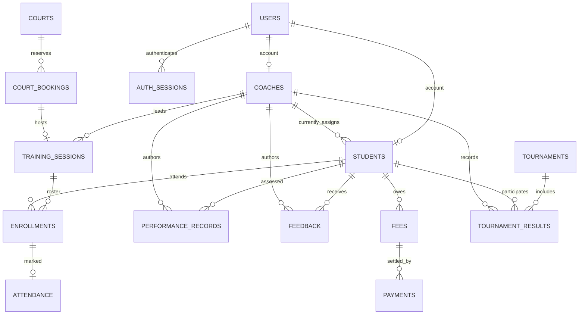

# Database reference

The deployment database is MySQL 8.4 with InnoDB, UTF-8 (`utf8mb4`), SQLAlchemy, and Alembic migrations. The initial migration creates **16 domain/security tables**. SQLAlchemy also supports isolated SQLite tests with foreign keys enabled; MySQL remains the intended runtime.

## Tables

All tables have an integer `id` primary key. Foreign keys restrict deletion unless explicitly noted. All required columns are `NOT NULL`; only a student's current `coach_id` may be null.

| Table | Important columns | Purpose and relationships |
|---|---|---|
| `users` | unique `login_id`, `password_hash`, `role`, `name`, `email`, `active`, `created_at` | One account per administrator, coach, or student; allowed roles ADMIN/COACH/STUDENT |
| `coaches` | unique FK `user_id`, `specialty`, `phone` | One-to-one coach account; one coach can have many current students and sessions |
| `students` | unique FK `user_id`, nullable FK `coach_id`, `date_of_birth`, `joined_on`, `level`, `phone` | One-to-one student account; Beginner/Intermediate/Advanced levels |
| `auth_sessions` | unique `token_hash`, FK `user_id`, `expires_at` | Revocable hashed bearer tokens; expires after eight hours; user FK has ON DELETE CASCADE |
| `login_attempts` | indexed `key_hash`, `attempted_at` | Rolling failed-login limits for hashed account and source identifiers |
| `courts` | unique `name` | Court inventory and stable rows used for reservation locking |
| `court_bookings` | FK `court_id`, FK `created_by`, `starts_at`, `ends_at`, `purpose` | Shared reservation ledger for training and standalone bookings; positive duration |
| `training_sessions` | FK `coach_id`, unique FK `booking_id`, `title`, `focus` | Exactly one court booking per training session |
| `enrollments` | FK `session_id`, FK `student_id` | Explicit session roster; unique session/student pair |
| `attendance` | unique FK `enrollment_id`, `status`, FK `marked_by`, `marked_at` | At most one current mark per enrollment; present/absent/excused; update uses PUT |
| `performance_records` | FK `student_id`, FK `coach_id`, `recorded_on`, `agility`, `endurance`, `footwork`, `technique`, `notes` | Dated coach assessments; every score constrained to 0–100 |
| `feedback` | FK `student_id`, FK `coach_id`, `recorded_on`, `message` | Individual dated coaching advice |
| `fees` | FK `student_id`, `description`, `amount`, `due_date`, `created_on` | Positive decimal charges; one charge can have multiple partial payments |
| `payments` | FK `fee_id`, positive `amount`, `paid_on`, `method`, unique `reference`, FK `recorded_by` | Immutable receipt history; cash/bank/card/upi; belongs to a student through its fee |
| `tournaments` | `name`, `location`, `event_date` | Tournament catalogue |
| `tournament_results` | FK `tournament_id`, FK `student_id`, FK `coach_id`, `category`, `result`, `achievement` | Participation/results; unique tournament/student/category combination |


## Relationships



A user's role/profile pairing is maintained by the controlled account-creation services: creating a coach/student also creates the matching user in one transaction. There is no public role-change endpoint. Administrators have no student/coach profile.

## Types and indexes

- Monetary values: `NUMERIC(10,2)`, maximum 99,999,999.99. The API rejects fractional cents, nonfinite/zero/negative values, and overpayments. Do not use floats for ledger calculations.
- Session/security timestamps: naive UTC internally, `DATETIME(6)` on MySQL, ISO datetime with `Z` externally. Microseconds matter for adjacent booking boundaries.
- Business dates: SQL `DATE` for birth, joining, assessments, fee/payment dates, and tournaments.
- Important lookup/filter indexes: student coach assignment, booking court and start, session coach, enrollments student/session, record student/date, fee student/due date, payment fee/date, tournament event date, token expiry, and attempt key/time. Unique keys are indexed by MySQL.
- Text fields have explicit maximum lengths: identifiers 40; names 100–120; phone 30; notes 1000; feedback 2000; booking purpose/fee description/achievement 200. API validation matches model limits.

## Integrity and business rules

Database constraints enforce existing foreign-key references, unique identifiers/receipts/enrollments, valid roles/statuses/payment methods/levels, positive booking durations and monetary values, and score bounds.

Additional service rules enforce active assigned students/coaches, birth date before joining, no future joining/birth/performance/feedback dates, booking duration at most eight hours, no bookings moved into the past, no court overlaps, no overlapping coach sessions, valid enrollment before attendance, no future attendance, immutable fee ownership, and no overpayments.

Court and coach rows are locked with `FOR UPDATE` before schedule writes. Conflicting reservations are checked with a current locking read. Fee and payment rows are locked before balance-sensitive writes. This protects races on MySQL, which SQLite tests cannot simulate.

## Deletion and history

- Unused students/coaches can be physically deleted; linked academic/financial rows prevent deletion with HTTP 409. A coach with assigned students must first be unassigned/reassigned.
- Deactivation preserves profiles/history, rejects new login, and revokes tokens. Active students must be reassigned or deactivated before their coach is deactivated.
- Changing coach assignment does not rewrite historical authors or session enrollments. Coach access to student records follows the student's current assignment; access to an own session remains tied to its original coach. Former coaches cannot mark attendance for reassigned students.
- Training sessions without attendance can be deleted together with their enrollment rows and booking. Sessions with attendance cannot be deleted or have timing/roster changed. Their title/focus can still be corrected.
- A standalone booking can be deleted. A booking used by a training session must be managed through the session.
- Paid fees cannot be deleted or reduced below their total payments. Payment entries have no update/delete endpoint.
- Tournament deletion is blocked while results exist. Progress/feedback/results can be edited/deleted by an administrator or their author coach while the student is assigned to that coach.

## Seed data

`flask --app backend:create_app seed-demo` requires an empty users table and a password entered securely at the prompt. It creates 1 administrator, 2 coaches, 6 students, 3 courts, 14 sessions with rosters, 24 attendance marks, 48 weekly performance records, 6 feedback notes, 18 fees with partial/full payments, 1 tournament, and 4 results including 2 medal achievements. Dates are relative to the current academy date. All names and contacts are fictional and use `example.com`.

For a clean production setup, use `create-admin` instead of `seed-demo`. Add your court inventory from the Admin Court bookings page before creating schedules.

## Migration commands

```bash
flask --app backend:create_app db upgrade
flask --app backend:create_app db current
flask --app backend:create_app db check
```

Apply migrations before provisioning accounts. Back up MySQL before schema upgrades. Initial schema migration and MySQL schema/model parity were checked during delivery; see `TEST_RESULTS.md`.
