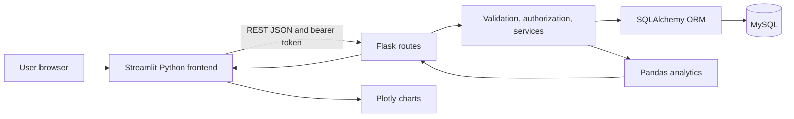

# How the project works

The application has three distinct layers. **Streamlit** draws the screens. **Flask** receives HTTP requests and decides which operations are allowed. **MySQL** stores records permanently. SQLAlchemy translates Python queries into SQL. Pandas groups data into report tables; Plotly draws interactive charts from those tables.



## Project structure

```text
backend/
  __init__.py                Application factory, configuration, errors, CLI
  extensions.py              Shared SQLAlchemy and migration objects
  models.py                  Database table definitions and relationships
  routes/
    auth.py                  Login, identity, logout, password changes
    people.py                Students, coaches, assignments, deactivation
    scheduling.py            Courts, reservations, training, attendance
    records.py               Performance, feedback, tournaments/results
    finance.py               Fees, payments, financial history
    analytics.py             Dashboard aggregates, reports, metadata
  services/
    people.py                Profile validation and row access checks
    scheduling.py            Reservation locks, overlap/enrollment rules
    serialization.py         ORM rows to safe JSON data
    analytics.py             Pandas grouping and monthly calculations
    seed.py                  Fictional realistic demonstration records
  utils/
    validation.py            Strict input parsing and client-facing errors
    security.py              Hashed tokens and role decorators
    time.py                  Academy-local business date
frontend/
  app.py                     Role login, sidebar, authenticated page routing
  client.py                  HTTP API client and mutation notifications
  views.py                   Forms, searchable tables, charts, dashboards
migrations/                  Versioned Alembic schema history
.streamlit/config.toml       Native Streamlit theme
requirements.txt             Pinned Python dependencies
compose.yaml, Dockerfile     Optional reproducible deployment
.env.example                 Configuration template, no working credentials
pytest.ini, tests/           Automated validation
```

## Start with the backend factory

`create_app()` creates a Flask application rather than starting a server immediately. This lets production servers and tests create separate instances. It loads configuration, initializes database/migration extensions, registers route groups, and installs error handlers. It does not run `create_all()` on startup: schema changes are applied deliberately through migrations.

`extensions.py` holds the shared database object. Keeping it separate avoids circular imports, where two Python modules repeatedly import each other.

## Models are Python descriptions of database tables

A model such as `Student` describes its columns (`date_of_birth`, `level`, `coach_id`) and connections to other tables. Its `user` relationship lets Python access account details without copying names/passwords into multiple tables. Foreign keys ensure referenced students, coaches, and sessions actually exist. Unique constraints reject duplicates. Check constraints enforce acceptable role, status, duration, score, and amount values even when data is inserted outside the API.

A student has one current assigned coach. A training session has explicit enrollments, so attendance represents real participants rather than every student currently assigned to a coach. Student records retain their author coach and historical session enrollments when assignments change.

## Routes handle requests; services hold reusable rules

A route is the function Flask calls for an HTTP method and path. For example, `POST /api/sessions` first verifies the caller's role, reads a JSON object, calls `save_session()`, commits the transaction, and returns JSON.

Services centralize rules used by multiple routes. `student_access()` verifies a particular student's visibility. `reserve()` serializes competing writes and checks court availability. `serialize()` turns dates, decimals, and relationship data into JSON without exposing password/token hashes.

Utilities perform small reusable tasks: parse dates, reject unexpected fields, validate amounts, hash session tokens, and report errors consistently. `APIError` is an expected user input/access error. Database uniqueness and foreign-key failures become HTTP 409 responses. Unexpected errors are logged on the backend and return a generic message to the client.

## Authentication step by step

1. The user chooses a role and submits an academy ID and password in Streamlit.
2. Streamlit calls Flask's `/auth/login` endpoint.
3. Flask checks recent failed attempts and verifies the salted password hash. Wrong role, wrong password, unknown ID, and inactive account receive the same credential error.
4. Flask generates a random token, stores only its hash with an expiration, and returns the token to the Streamlit server session.
5. The frontend sends `Authorization: Bearer ...` on later requests.
6. The `@require()` decorator looks up the token hash and checks expiry, active state, and role before running a route.
7. Record-level checks still apply after role checks: a coach cannot access another coach's students just by changing an ID in a request.
8. Logout removes the token. Password change/reset removes every token for the account.

The frontend's menu helps navigation; it is not the security boundary. The Flask API independently rejects unauthorized calls.

## Why transactions and locks matter

A transaction groups related changes into one commit. Creating a training session also creates its court booking and enrollments. If any rule fails, all changes roll back together.

Without locks, two requests might both check that a court is free and then both reserve it. MySQL `SELECT ... FOR UPDATE` locks the court row while availability is checked and written. A coach row similarly prevents simultaneous sessions on different courts. Payment requests lock the fee row before checking its remaining balance. The conflict reads also use locking reads so MySQL's default snapshot isolation cannot conceal a recently committed competing write.

Financial values use `Decimal` and SQL `NUMERIC(10,2)` instead of binary floating point. JSON represents money as decimal strings. Plotly's display-only aggregations convert amounts to numbers for charting; authoritative ledger balances remain decimal calculations.

## Streamlit pages

`app.py` configures the page, renders login, revalidates the account on every rerun, and selects a page from the role's sidebar. `client.py` performs HTTP requests with timeouts and converts backend errors to readable notifications. Successful mutations rerun the page so tables and charts show saved data.

`views.py` uses reusable table, picker, editor, and form helpers. Admin pages expose all management features. Coach pages show assigned students and academic actions. Student pages are read-only except for password changes. Forms collect input but do not make authorization decisions or execute SQL.

Streamlit reruns Python after a widget interaction. `st.session_state` remembers the login token, selected navigation, and success notification across those reruns. It belongs to that user's Streamlit session, not a shared global variable.

## Analytics and reports

`attendance_counts()` compares past enrollments with recorded marks. Excused sessions are removed from the denominator; missing marks remain visible as unmarked. A zero denominator produces no percentage rather than a misleading 0%.

`dashboard()` scopes students first, calculates attendance and achievement counts, groups performance by month with Pandas, and adds finance totals only for roles allowed to see money. The frontend then builds Plotly lines, bars, and donut charts.

`monthly_report()` uses academy-local month boundaries converted to UTC for session timestamps, business dates for payments/fees, and exact decimal balance calculations. Its CSV exporter prefixes spreadsheet formulas in user-entered names, protecting people who open downloaded reports in spreadsheet applications. Historical balances reflect current fee amounts; exported reports are the stable snapshot.

## Tests and development phases

The work was built in phases: schema/authentication/login; role-scoped management and dashboards; seed data and reporting; then documentation and operational checks. Tests run the real Flask routes against isolated databases. Frontend tests execute the real Streamlit script with HTTP calls routed into Flask's test client. MySQL-specific tests use concurrent requests to check booking/payment locks.

SQLite tests are convenient and fast but cannot establish MySQL locking behavior. The integration suite therefore accepts a dedicated MySQL test URL. The test fixture drops domain tables; it must never be used with production data. `TEST_RESULTS.md` distinguishes executed checks from things not tested.

## Extending the system

For a new metric or feature, start with the model/schema change, review a migration, add validation and authorization in a service/route, then build its Streamlit view. Add tests for the actual risks: unauthorized access, invalid values, broken relationships, or concurrent balance/booking errors. Keep secrets in environment variables and all business rules in Flask.
